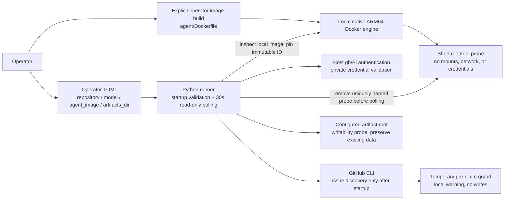

# Service Architecture: Autonomous Coding Factory

One operator-owned local Python runner coordinates one trusted target repository.
GitHub holds durable coordination; no database, broker, HTTP API, or hosted
application exists.

## Current implementation: US-04

The runner validates the new four-field TOML, writable artifact root, host tools
and authentication, local native ARM64 Docker, a compatible already-local shared
image, and native root/tool execution. It retains the resolved immutable image ID
and engine endpoint for the session, then polls every 30 seconds.

An operator-approved temporary pre-claim guard reports discovered issues locally
without consuming triggers, writing status, creating issue workspaces, executing
agent work, or publishing. Direct issue dispatch has the same guard. There is no
legacy execution-backend selector. US-05 will replace the guard with the accepted
Docker-enabled issue-to-PR behavior.

### Source and test evidence

| Boundary | Source | Evidence |
| --- | --- | --- |
| Four-field TOML and migration errors | [config.py](../../src/software_factory/config.py) | [config tests](../../tests/test_config.py) |
| Safe terminal failures and SIGTERM exit 130 | [entrypoint](../../src/software_factory/__main__.py) | [CLI tests](../../tests/test_cli.py), real startup E2E below |
| Local engine/image validation, immutable session ID, bounded probe cleanup | [runner.py](../../src/software_factory/runner.py) | [startup tests](../../tests/test_startup.py) |
| Read-only discovery and guarded dispatch | [runner.py](../../src/software_factory/runner.py), [github.py](../../src/software_factory/github.py) | startup guard tests and labeled-issue E2E variant |
| Pinned native shared baseline | [Dockerfile](../../agent/Dockerfile), [build instructions](../../agent/README.md) | [real image/tool checks](../../tests/test_startup_docker.py) |
| Real CLI → TOML → Docker probe/cleanup → polling → SIGTERM | CLI and runner | [startup E2E](../../tests/test_startup_docker.py); GitHub and host authentication are scripted, not live acceptance |
| Development verification | [Makefile](../../Makefile), [ARM64 CI](../../.github/workflows/verify.yml) | Ruff, Python overall line/branch and Node line/branch/function coverage gates ≥80% |

## Target execution: US-05–US-07, not yet active

[Contracts](../contracts.md) define the remaining execution path:

1. Exact open factory-PR/branch checks, confirmed trigger removal, and immutable
   issue title/body snapshot; fresh default-branch workspace under one 900-second
   deadline.
2. One root agent container from the pinned shared image, with same-absolute-path
   workspace mount, local engine access, and normal credential separation.
3. Setup → exact-model Pi/Copilot implementation → canonical verification, with
   service-backed checks and explicit addresses for sibling services.
4. Unique run identity and cooperative Compose/direct-Docker ownership labels;
   host-controlled cleanup of known owned containers, networks, and disposable
   volumes before publication. Preserve unrelated resources/images/cache.
5. Host-owned trusted Git metadata, nonempty verified changes, create-only remote
   branch, draft PR, and concise issue outcome; private failure retention.
6. US-06 adds bounded recovery using failed verification feedback in the same
   environment/deadline. US-07 adds fresh explicit manual requeue without recovery
   from retained diagnostics.

Reusable GitHub, trusted Git, process/deadline, Copilot metadata, Pi bridge, and
verification-feedback boundaries retain independent tests. Historical Compose
helpers and their tests are not a selectable backend. Old orchestration/requeue
regressions are explicitly skipped until ported; US-05 includes their replacement
and removal audit. Historical live US-01–US-03 acceptance belongs to the previous
runtime and is preserved in git history, not proof of these new boundaries.

## Trust model and evidence limits

Root plus Docker engine access grants effective engine/host control. The future
agent environment is not a host-file or credential security boundary. Limited
ordinary mounts/stdin credentials/trusted Git metadata remain useful but do not
prevent deliberate Docker-mediated access. Run labels scope cooperative cleanup,
not access control. Unknown resources and hard-crash leftovers require operator
inspection, never broad pruning.

Local startup tests prove native tool execution and clean polling with scripted
external boundaries. They do not prove engine socket access from an issue run,
same-path sibling mounts, host-usable files, application build/Compose/service
verification, macOS browser connectivity, issue-run cleanup, repairs, requeue, or
publication. Linux ARM64 CI cannot establish desktop sharing/networking. These
remain explicit US-05–US-07 checks. No new live authenticated Copilot/GitHub-writing
demonstration is required or authorized.

See [current slice](../slices/current-slice.md), [workflow](../workflows/issue-to-draft-pr.md),
and [operator setup](../../README.md#operator-setup). Update the accepted spec and
contracts before changing interfaces or policy; do not mix old isolation claims
with Docker access.
