# Service Architecture: Autonomous Coding Factory

Component-level architecture and the primary US-01 workflow. The operator runs
one local factory against one trusted target repository; GitHub holds durable
coordination state. There is no HTTP server, message broker, or database.

## Evidence status

- **Implemented:** backed by source, not necessarily proven against live services end to end.
- **Integration-tested:** real Git/process/Docker tests and a real Pi/Copilot coding probe passed locally.
- **Specified only:** US-02 repair recovery and US-03's successful manual-requeue acceptance flow.
- **Not accepted end to end:** the live issue-to-linked-draft-PR test has not passed;
  see [current slice](../slices/current-slice.md) and [live test](../../tests/test_e2e.py#L14).

## Architecture diagram

All solid connections describe implemented orchestration. Target CI/human review
is external, specified follow-on behavior, not executed by the factory.

```mermaid
flowchart LR
    OP(["Operator"])
    REVIEW(["Human reviewer"])
    subgraph HOST["Operator host: local factory, no inbound endpoint"]
        CONFIG[/"Trusted TOML + Compose configuration"/]
        RUN["Local runner<br/>Python 3.14 terminal process<br/>30s polling, one issue run, 900s budget"]
        GH["Host GitHub CLI<br/>REST API over HTTPS<br/>host-only GitHub credentials"]
        GIT["Host Git<br/>trusted metadata outside workspace"]
        AUTH["Host Pi authentication<br/>Copilot-only bearer, lifetime at least 20m"]
        WS[("Fresh per-run workspace<br/>default-branch repository contents")]
        LOG[("Private local artifacts<br/>failed workspace and run.log")]
    end
    subgraph SANDBOX["Unique per-run Docker Compose project"]
        AGENT["Prepared agent service<br/>Node + Pi + repository toolchain<br/>temporary Pi configuration"]
        CHECK["Repository scripts<br/>setup and verify"]
        DEP["Optional local dependency services"]
    end
    REMOTE[("GitHub.com target repository<br/>issues, labels, comments, branches, draft PRs")]
    COP["GitHub Copilot API<br/>validated HTTPS endpoint"]
    CI["Target repository CI"]

    OP -->|"1. start terminal runner"| RUN
    CONFIG -->|"1. validate and freeze"| RUN
    OP -->|"2. apply agent:implement"| REMOTE
    RUN -->|"2-3, 9-10. invoke gh"| GH
    GH <-->|"2-3. poll, duplicate checks, claim, snapshot"| REMOTE
    RUN -->|"4, 9. invoke git"| GIT
    REMOTE -->|"4. fetch default branch over HTTPS"| GIT
    GIT -->|"4. checkout with separate metadata"| WS
    RUN -->|"5. resolve privately"| AUTH
    RUN -->|"5. start project; bearer and task via stdin"| AGENT
    WS <-->|"workspace-only bind mount at /workspace"| AGENT
    AGENT -->|"6. setup; 8. verify"| CHECK
    CHECK -->|"dependency-backed checks over local network"| DEP
    AGENT <-->|"7. implementation request and model responses"| COP
    RUN -->|"8. stop and remove containers before publication"| SANDBOX
    GIT -->|"9. non-force push factory/issue-N"| REMOTE
    GH -->|"9. draft PR; 10. outcome comment"| REMOTE
    RUN -->|"10. retain diagnostics on failure"| LOG
    REMOTE -.->|"11. independent checks"| CI
    REMOTE -.->|"11. review and merge decision"| REVIEW
    CI -.->|"11. results"| REVIEW
```

## Components and interaction evidence

| Component / boundary | Responsibility and interface | Supporting evidence |
| --- | --- | --- |
| Operator configuration → runner | Required repository, Compose file/service, exact Copilot model; relative paths resolved at startup | [config.py L20](../../src/software_factory/config.py#L20), [contracts: configuration](../contracts.md#contract-1-local-runner-invocation-and-repository-configuration) |
| Terminal runner | Serial polling and issue-run orchestration; SIGTERM/Ctrl-C cleanup | [runner.py L53](../../src/software_factory/runner.py#L53), [entrypoint L14](../../src/software_factory/__main__.py#L14) |
| Runner → GitHub CLI → GitHub REST API | Paginated issue discovery, exact PR/ref checks, label removal, snapshots, comments and draft PR creation; payloads via stdin | [github.py L17](../../src/software_factory/github.py#L17), [github.py L50](../../src/software_factory/github.py#L50) |
| Runner → host Git → workspace/remote | Fresh fetch/checkout; host-owned metadata, hooks/config isolation; commit nonempty changes and push without force | [repository.py L11](../../src/software_factory/repository.py#L11), [repository.py L58](../../src/software_factory/repository.py#L58) |
| Runner → host Pi auth → sandbox | Copilot bearer resolution without printing credentials; private stdin payload; known endpoint/lifetime checks | [runner.py L95](../../src/software_factory/runner.py#L95), [sandbox.py L100](../../src/software_factory/sandbox.py#L100) |
| Runner → Docker Compose | Frozen operator configuration; unique project; all services validated; lifecycle controlled outside the workspace | [preflight L20](../../src/software_factory/runner.py#L20), [sandbox validation L53](../../src/software_factory/sandbox.py#L53), [lifecycle L111](../../src/software_factory/sandbox.py#L111) |
| Workspace ↔ agent | Only `/workspace` bind mount; Git metadata stays outside it; no host Docker socket or GitHub credentials | [sandbox.py L61](../../src/software_factory/sandbox.py#L61), [repository.py L11](../../src/software_factory/repository.py#L11) |
| Pi ↔ Copilot API | One-shot print mode with exact model, coding tools, ephemeral auth/config; discovered resources/session persistence disabled | [sandbox_agent.mjs](../../src/software_factory/sandbox_agent.mjs), [wrapper tests](../../tests/test_agent_wrapper.py) |
| Repository scripts → local dependency services | Exit status is the verification protocol; prepared private bridge networks and anonymous volumes, no host ports/shared resources | [sandbox.py L137](../../src/software_factory/sandbox.py#L137), [real dependency test](../../tests/test_docker_integration.py#L100) |
| Private diagnostic store | Mode-0700 run directories, mode-0600 redacted command logs; failure retention, no resumption | [runner.py L68](../../src/software_factory/runner.py#L68), [process.py L23](../../src/software_factory/process.py#L23), [.gitignore](../../.gitignore) |
| Independent target CI / reviewer | External follow-on checks; reviewer owns merge; factory does not revise PRs from feedback | [SPEC.md L57](../../SPEC.md#L57) |
| Factory development CI | Separate from target CI: formatting, lint, real Docker tests, Python and Node Pi-bridge coverage gates ≥80% | [verify workflow](../../.github/workflows/verify.yml), [Makefile](../../Makefile) |

## Numbered workflow

1. **Start and validate.** Load the four-field TOML, check host tools/GitHub authentication/Docker, resolve Compose with a restricted environment, and freeze supported isolation settings. Invalid startup inputs fail before a claim. [entrypoint](../../src/software_factory/__main__.py#L19), [preflight](../../src/software_factory/runner.py#L20)
2. **Discover.** Operator applies `agent:implement`; each serial poll discovers all matching open issues, excluding PRs. Polling sleeps 30 seconds between completed batches. [runner](../../src/software_factory/runner.py#L53), [discovery](../../src/software_factory/github.py#L50)
3. **Skip or claim.** Check exact head repository/`factory/issue-N` PR identity and remote branch. Existing PR → remove label, link PR, skip; branch without PR → remove label, request operator cleanup, skip. Otherwise confirm label removal, post running status, and snapshot only title/body. [coordination](../../src/software_factory/runner.py#L68), [GitHub boundaries](../../src/software_factory/github.py#L63)
4. **Create workspace.** Fetch the discovered default branch into trusted host Git metadata, check out fresh contents into the exposed workspace, and record the base commit. The 900-second budget already covers duplicate/claim/workspace operations. [repository](../../src/software_factory/repository.py#L58), [budget](../../src/software_factory/runner.py#L70)
5. **Authenticate and start sandbox.** Resolve a Copilot-only bearer with at least 20 minutes remaining; validate its endpoint metadata. Start a unique Compose project. Credentials and the immutable task snapshot reach the Node/Pi bridge through stdin, not host mounts or command arguments. [runner](../../src/software_factory/runner.py#L95), [sandbox](../../src/software_factory/sandbox.py#L100)
6. **Set up.** Inside the sandbox, require both executable scripts and run `./scripts/setup`. Missing entrypoints or setup failure blocks implementation. [setup boundary](../../src/software_factory/sandbox.py#L137), [Docker failure tests](../../tests/test_docker_integration.py#L114)
7. **Implement.** Pi receives the snapshot and repository contents with coding tools enabled, no clarification stage, no issue-thread/link retrieval, no inherited host Pi resources, and no provider fallback. Temporary configuration is removed after invocation. [Pi bridge](../../src/software_factory/sandbox_agent.mjs), [real Copilot probe](../../tests/test_docker_integration.py#L132)
8. **Verify and freeze.** Execute `./scripts/verify` once. Failure ends US-01; repairs remain deferred. On success, stop/remove all project containers before reading workspace changes for publication. Timeout/interruption also attempts cleanup. [runner](../../src/software_factory/runner.py#L118), [deadline handling](../../src/software_factory/process.py#L23), [real cleanup test](../../tests/test_docker_integration.py#L178)
9. **Publish.** Require a nonempty staged diff, commit with trusted host metadata, recheck branch absence, push once without force, and create a draft PR containing `Closes #N`. No changes or publication errors are failures. Uncertain remote writes are observed, never blindly repeated. [host publication](../../src/software_factory/repository.py#L65), [PR contract implementation](../../src/software_factory/github.py#L120), [orchestration](../../src/software_factory/runner.py#L125)
10. **Report.** Post the actual PR URL on success and delete the successful run directory. On failure, post a concise reason when claimed, retain private workspace/logs, and report reporting/cleanup errors locally. The runner never adds back the trigger or resumes diagnostics. [outcome handling](../../src/software_factory/runner.py#L129), [failure tests](../../tests/test_runner.py)
11. **Review externally.** Target CI and the human reviewer assess the published draft PR. These are specified external responsibilities, not factory-controlled steps. [SPEC.md L57](../../SPEC.md#L57)

## Assumptions and unresolved questions

- **Operator-owned prerequisites:** only one runner operates on the repository; labels are not a distributed lock. Prepared images/configuration are trusted, contain no broader credentials, and provide the target's real dependency-backed checks. See [operator setup](../../README.md#operator-setup).
- **Live acceptance blocked:** the inspected smoke target's default branch still contains only Markdown files. Its preparation branch must be merged by the operator, and a Pi-capable agent image/Compose environment supplied. No preparation merge or live GitHub write was performed during this implementation.
- **Evidence limit:** the real Pi probe proves isolated coding/authentication, not a full GitHub issue-to-PR run or automatic credential renewal. The opt-in [end-to-end test](../../tests/test_e2e.py) remains unpassed. Earlier feasibility results in [DECISIONS.md L140-146](../../DECISIONS.md#L140) are recorded claims; their ignored raw artifacts are absent from this checkout.
- **Deferred behavior:** [US-02](../../SPEC.md#us-02-recover-a-verification-failure-through-bounded-repairs) adds up to three repairs; [US-03](../../SPEC.md#us-03-manually-requeue-a-failed-or-interrupted-issue) proves successful manual requeue. Neither is claimed complete here.
- **Implementation limits:** Compose uses a fail-closed supported subset; images are prebuilt, dependency volumes anonymous, all capabilities dropped, and nested Git metadata rejected. These are documented constraints, not inferred support for arbitrary Compose environments.
- **Residual risks:** internet-enabled agent code can exfiltrate sandbox-accessible data; GitHub writes/label changes are not atomic; a hard host crash may leave containers/status/branches; command output is buffered in host memory. Human review and operator cleanup remain necessary.
- **No runtime protocol inference:** GitHub uses explicit REST calls through `gh`, Git uses HTTPS remotes, and Copilot uses its validated HTTPS endpoint. Actual dependency protocols are target-specific; only the test HTTP dependency is evidenced, not a production database or queue.

## Changing the architecture safely

Update [SPEC.md](../../SPEC.md) and [contracts](../contracts.md) before interface or
policy changes. Add boundary/failure tests and real integration evidence, keep
[this diagram](service-architecture.md) and the [operator guide](../../README.md)
consistent, and do not mark the slice done on mocked or partial-probe evidence.
