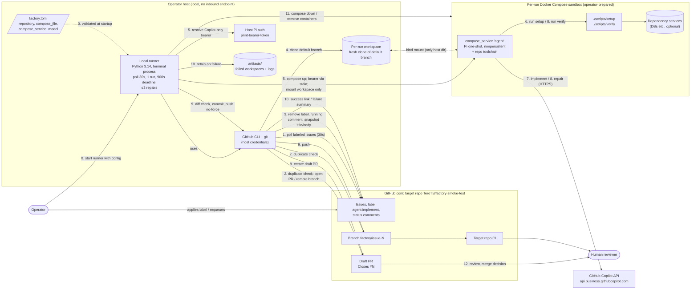

# Service Architecture: Autonomous Coding Factory

Scope: component-level (≈C4 L2) view plus the primary issue-to-draft-PR workflow (US-01 + US-02).

## Evidence status

**No factory implementation exists.** `src/` contains only `.gitkeep`
([README.md L4, L36](../../README.md#L4)). Every runtime component below is **specified**
(accepted design in [SPEC.md](../../SPEC.md), [DECISIONS.md](../../DECISIONS.md),
[docs/contracts.md](../contracts.md)), not verified in code.

| Label | Meaning |
| --- | --- |
| **[S]** Specified | Stated in accepted spec/decisions/contracts; no code yet. |
| **[P]** Probed | Feasibility probe result recorded in `DECISIONS.md`; raw evidence not in repo. |
| **[V]** Verified in repo | Backed by committed, executable files. |
| **[I]** Inferred | Not stated explicitly; derived by this document. |

## Architecture diagram

Not shown: US-03 manual requeue reuses steps 1–12 after the operator reapplies the label.

## Components

| Component | Responsibility | Status | Evidence |
| --- | --- | --- | --- |
| Operator | Prepares target repo + Compose, authenticates, runs factory, labels, requeues, cleans up | [S] | [DECISIONS.md L19, L99](../../DECISIONS.md#L19), [CONTEXT.md L9-11](../../CONTEXT.md#L9) |
| `factory.toml` | Four required fields; no credentials or command templates | [S] | [contracts.md L20-61](../contracts.md#L20) |
| Local runner | Polls, claims, orchestrates sandbox/Pi/verify, enforces deadline and repair count, publishes | [S] | [DECISIONS.md L20, L66, L133](../../DECISIONS.md#L133), [contracts.md L28-30](../contracts.md#L28) |
| GitHub CLI + git (host) | All GitHub reads/writes; credentials never enter sandbox | [S] | [DECISIONS.md L69, L80](../../DECISIONS.md#L69), [contracts.md L221-224](../contracts.md#L221) |
| Host Pi auth | Resolves Copilot-only bearer (`--min-expiry 20m`) | [S][P] | [contracts.md L128-135](../contracts.md#L128), [DECISIONS.md L140-141](../../DECISIONS.md#L140) |
| Per-run workspace | Fresh default-branch checkout; only host dir exposed | [S] | [SPEC.md L46, L49](../../SPEC.md#L46) |
| Compose sandbox / agent service | Runs Pi, setup, verify, generated commands; internet allowed; no Docker socket | [S][P] | [contracts.md L105-156](../contracts.md#L105), [DECISIONS.md L142, L145](../../DECISIONS.md#L142) |
| `./scripts/setup`, `./scripts/verify` | Target-repo golden-path contract; exit 0 = success | [S] | [contracts.md L158-197](../contracts.md#L158) |
| Dependency services | Optional DBs/services in Compose | [S] | [SPEC.md L48](../../SPEC.md#L48); smoke target has none ([DECISIONS.md L146](../../DECISIONS.md#L146)) |
| GitHub (issues, branches, PRs) | Durable coordination; no database | [S] | [DECISIONS.md L23, L58, L112](../../DECISIONS.md#L58) |
| Copilot API | LLM provider; no fallback provider | [S][P] | [DECISIONS.md L68, L81, L141](../../DECISIONS.md#L141) |
| `artifacts/` | Local failed-run retention, git-ignored | [S][V] ignore rule | [README.md L64-65](../../README.md#L64), [contracts.md L259-262](../contracts.md#L259) |
| Factory CI | Repo's own verify workflow (dev toolchain only) | [V] | [.github/workflows/verify.yml](../../.github/workflows/verify.yml), [Makefile L21-24](../../Makefile#L21) |

## Workflow walkthrough

0. **Start** — Operator runs `uv run --frozen python -m software_factory --config factory.toml`. Config validated before any claim; invalid config → nonzero exit. [S] [contracts.md L28-61](../contracts.md#L28)
1. **Poll** — Every 30 s, list `agent:implement` issues in the one target repo via host `gh`. One issue run at a time. [S] [SPEC.md L10, L43](../../SPEC.md#L10), [contracts.md L69-70](../contracts.md#L69)
2. **Duplicate check** — Open PR with exact head `factory/issue-<N>` → remove label, comment link, skip. Remote branch without PR → remove label, request deletion, skip. [S] [SPEC.md L44-45](../../SPEC.md#L44), [contracts.md L86-96](../contracts.md#L86)
3. **Claim + snapshot** — Remove label (confirmed), post running comment, snapshot title/body and base commit. 900 s deadline starts. [S] [SPEC.md L46](../../SPEC.md#L46), [contracts.md L73-79, L180-182](../contracts.md#L73)
4. **Workspace** — Fresh isolated workspace from the default branch (discovered from GitHub). [S] [contracts.md L49, L91-92](../contracts.md#L91). Clone mechanism (`gh`/`git`) is [I].
5. **Sandbox start** — Host resolves Copilot bearer, starts Compose service, passes bearer via private channel (stdin per probe), mounts only the workspace. [S][P] [contracts.md L128-148](../contracts.md#L128), [DECISIONS.md L140](../../DECISIONS.md#L140)
6. **Setup** — `./scripts/setup` inside sandbox; missing script or failure fails the run. [S] [SPEC.md L50-51](../../SPEC.md#L50), [contracts.md L193](../contracts.md#L193)
7. **Implement** — Pi one-shot print mode, explicit `github-copilot` model, extensions/MCP/skills disabled, input = snapshot + repo. [S] [contracts.md L117-124](../contracts.md#L117), [SPEC.md L47](../../SPEC.md#L47)
8. **Verify + repair loop** — `./scripts/verify`; on failure, verify output → Pi repair → verify, max 3 repairs, shared deadline. [S] [SPEC.md L77-82](../../SPEC.md#L77), [contracts.md L183-186](../contracts.md#L183)
9. **Publish** — On pass with nonempty diff: host commit, non-force push to `factory/issue-<N>`, `gh` draft PR with `Closes #<N>`. Empty diff → `no changes produced` failure. [S] [SPEC.md L52-53](../../SPEC.md#L52), [contracts.md L199-229](../contracts.md#L199)
10. **Report** — Issue comment: success with actual PR URL, or concise failure reason. Failed workspace/logs retained locally. [S] [contracts.md L240-262](../contracts.md#L240)
11. **Cleanup** — Stop/remove run-owned containers on completion, expiry, or operator stop. No auto-resume. [S] [SPEC.md L56](../../SPEC.md#L56), [contracts.md L154-156](../contracts.md#L154)
12. **Review** — Target CI and human reviewer evaluate the draft PR; factory never merges or revises. [S] [SPEC.md L57](../../SPEC.md#L57)

## Assumptions (made by this document)

- [I] Host-side commit happens by reading the workspace from the host, since the sandbox has no write credentials ([contracts.md L221-224](../contracts.md#L221)). Exact mechanism not specified.
- [I] Bind mount is the workspace-sharing mechanism; contracts only say "no host directories beyond the run workspace".
- [I] Polling uses `gh` (CLI named for "issue access" in [DECISIONS.md L69](../../DECISIONS.md#L69)); API vs. `gh issue list` not specified.
- [I] Deadline enforcement mechanism (process kill, `compose down`) not specified.

## Gaps, ambiguities, inconsistencies

1. **No implementation.** Runner, config parser, sandbox orchestration, and publication are design-only. Only the dev toolchain is verified ([tests/test_toolchain.py](../../tests/test_toolchain.py)).
2. **Probe evidence not in repo.** `DECISIONS.md L145` cites `artifacts/feasibility/target-probe/`; it is git-ignored and absent from this checkout.
3. **Entrypoint vs. packaging.** Contract invokes `python -m software_factory`, but `pyproject.toml` sets `[tool.uv] package = false` with coverage source `src/` ([pyproject.toml L14-15, L28-30](../../pyproject.toml#L14)); how the module becomes importable is unresolved.
4. **Agent image lacks Pi.** Smoke target's verification image does not contain Pi ([contracts.md L280-282](../contracts.md#L280)); no agent Compose file exists in either repo.
5. **Target not ready.** Prep is on `chore/smoke-test-environment` (`c6d5b76`), not merged to `main` ([DECISIONS.md L146](../../DECISIONS.md#L146)).
6. **Credential lifetime.** Bearer requires ≥20 min validity for a 15 min run; automatic renewal untested ([SPEC.md L111](../../SPEC.md#L111)).
7. **Copilot endpoint selection.** Must be derived from token metadata; individual endpoint returned 401 ([DECISIONS.md L141](../../DECISIONS.md#L141)). Derivation logic unspecified.
8. **"Running status" wording.** SPEC/DECISIONS say "record running status"; contracts clarify it is a comment only, no status labels ([contracts.md L233-234](../contracts.md#L233)).
9. **Deadline start point.** SPEC says run deadline includes setup/implementation; contracts add workspace creation and publication ([contracts.md L180-182](../contracts.md#L180)) — consistent but stricter.
10. **Single-runner enforcement.** Only operator discipline; no lock ([DECISIONS.md L113](../../DECISIONS.md#L113)).
11. **Unresolved questions:** sandbox isolation validation method for full resolved Compose config; host-safe git metadata handling (hooks/filters) approach; where local run logs live beyond `artifacts/`.
