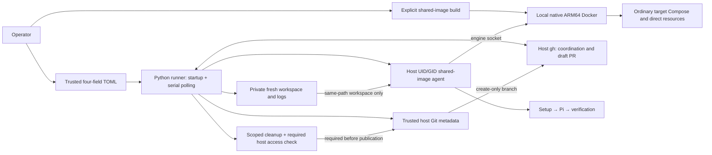

# Service Architecture: Autonomous Coding Factory

The factory turns labeled GitHub issues into verified draft PRs for human review.
One local runner coordinates one target repository and one issue run at a time.
GitHub holds durable coordination; there is no database, HTTP API, or hosted
application. [Contracts](../contracts.md) define boundary interfaces and safety
requirements; [SPEC](../../SPEC.md) defines product behavior.

## Components and boundaries

- **Operator:** prepares the Linux host, authenticates tools, builds the shared
  image, supplies configuration, and inspects failures.
- **Local runner:** validates prerequisites, polls issues, coordinates execution,
  gates publication, and reports results.
- **GitHub:** supplies issue snapshots and durable labels/comments/PRs.
- **Trusted host Git:** publishes verified changes through create-only branches;
  its metadata and publication credentials are not ordinary agent inputs.
- **Agent environment:** runs target setup, Pi implementation, and verification
  using the shared image and local Docker engine.
- **Docker engine:** runs the agent and ordinary target application/dependency
  services. Run ownership scopes cooperative cleanup.
- **Private artifacts:** retain failed workspaces and command diagnostics for
  operator inspection, not session recovery.

## Runtime flow

The operator prepares the host separately from runner startup. Startup validates
configuration, authentication, and the local engine/shared image before polling.
A claimed issue produces an immutable task snapshot and fresh workspace. Setup,
implementation, verification, cleanup, and publication share one deadline.

Passing verification is not sufficient for publication: owned mutating resources
must be stopped, scoped cleanup must complete, required host file access must
hold, and the diff must be nonempty. Uncertain remote writes require inspection,
not blind retries. Human review and independent target CI remain necessary.

## Local topology and trust

The persistent Lima VM provides native Linux storage and the local Docker engine.
SSH and explicit service forwarding provide host access without sharing macOS
execution directories. Agent and sibling services have separate localhost
interfaces; tests need explicit service addresses.

Docker access grants effective engine/host control. Container mounts, stdin
credentials, trusted Git metadata, and resource labels are not a security boundary
against deliberate Docker-mediated access. Cleanup preserves unrelated resources,
images, and cache. Unknown resources and hard-crash leftovers need manual
inspection, never broad pruning.

Boundary changes must update the accepted contracts and relevant boundary tests.
Keep operational commands in the [README](../../README.md) and runbooks, not here.
