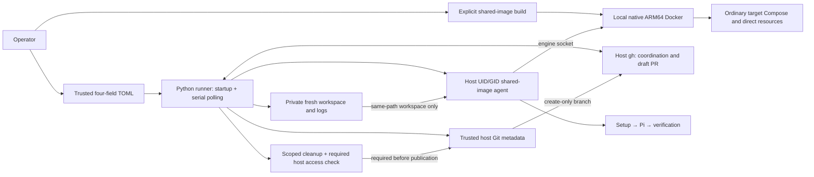

# Service Architecture: Autonomous Coding Factory

One operator-owned local Python runner coordinates one trusted target repository.
GitHub holds durable coordination; no database, broker, HTTP API, or hosted
application exists. [SPEC](../../SPEC.md) and [contracts](../contracts.md) define
accepted behavior; the [current slice](../slices/current-slice.md) records evidence.

## Current implementation: US-04 and US-05

Startup validates four-field TOML, artifact-root usability, host authentication,
local native ARM64 Docker, an already-local shared image, and native host-user/tool
execution with writable home/caches and explicit `sudo -n`. It retains the immutable image ID and resolved engine endpoint, removes
the uniquely named mount/network/credential-free probe, and begins serial polling.
The temporary pre-claim guard is removed; inspect existing trigger labels before
starting this version.

### Issue-run ordering

1. Check the exact configured head repository and `factory/issue-<number>` open PR,
   then remote branch. Confirm trigger removal before skip notification/execution.
   Preserve existing PRs/branches; never overwrite or delete a remote factory branch.
2. Create a fresh private run directory/workspace and immutable issue title/body
   snapshot with the discovered default-branch base commit. One original 900-second
   deadline includes preparation, builds/installations, execution, required cleanup,
   and publication. There is no restart/resume state.
3. Start one agent as the host UID/GID from the immutable shared image with a
   same-absolute-path workspace bind and local engine socket. Fixed isolated root
   code configures only container account/home/socket groups, never workspace
   permissions. Ordinary phases use that user; explicit system installs use `sudo -n`. On macOS the daemon socket mount is
   `/var/run/docker.sock`; the selected desktop host proxy is only for host commands.
   Normal inputs exclude trusted Git metadata and host publication credentials.
4. Require executable setup/verify scripts, run setup, then exact-model Pi with a
   Copilot-only bearer supplied through stdin and ephemeral nonpersistent config,
   then canonical verification. Docker transport/missing-script errors are distinct
   from completed verification failure. This delivery has no repair loop.
5. Ordinary Compose inherits matching unique `FACTORY_RUN_ID`/`COMPOSE_PROJECT_NAME`;
   direct resources use `software-factory.run-id`. Factory-owned containers request
   `--platform linux/arm64` and `--pull=never`; target commands inherit
   `DOCKER_DEFAULT_PLATFORM=linux/arm64` and use the unmodified image Docker client.
   Target scripts must use native-compatible images/tools. Explicit platform
   overrides are not intercepted and may invoke engine-supported emulation; the
   factory never selects an emulation fallback or substitutes dependencies.
   Ownership conventions are cooperative, not access controls.
6. Remove the agent first, independently discover exact owned resource identities,
   remove owned containers before networks/disposable volumes, and check required
   host publication access without changing workspace ownership/modes. Ignored caches
   need not be writable; deliberately restricted files require operator inspection.
   No target teardown code executes on the host. Cleanup/access failure blocks publication.
7. With passing verification, completed cleanup, remaining time, and nonempty changes,
   trusted host Git creates the absent branch and gh creates a draft PR containing
   `Closes #N`. Uncertain writes receive bounded read-only inspection, not retries.
   Failure status is concise; private failed artifacts remain until operator deletion.

## Source and test evidence

| Boundary | Source | Evidence |
| --- | --- | --- |
| Four-field TOML, migration, safe terminal failures | [config](../../src/software_factory/config.py), [CLI](../../src/software_factory/__main__.py) | config/CLI tests |
| Immutable image, local engine, bounded startup probe | [runner](../../src/software_factory/runner.py) | [startup tests](../../tests/test_startup.py), [real CLI startup](../../tests/test_startup_docker.py) |
| Exact duplicate/claim/snapshot/status/PR identity | [GitHub](../../src/software_factory/github.py) | GitHub boundary tests and [orchestration tests](../../tests/test_runner.py) |
| Shared-image execution, private Pi input, scoped cleanup | [agent lifecycle](../../src/software_factory/sandbox.py), [bridge](../../src/software_factory/sandbox_agent.mjs) | [unit tests](../../tests/test_sandbox.py), [real Docker suite](../../tests/test_docker_integration.py), Node bridge coverage |
| Native startup validation, factory platform flags, target default, original Docker client | [runner](../../src/software_factory/runner.py), [agent lifecycle](../../src/software_factory/sandbox.py) | [startup tests](../../tests/test_startup.py), [unit tests](../../tests/test_sandbox.py), [real Docker suite](../../tests/test_docker_integration.py) |
| Trusted Git and create-only push | [repository](../../src/software_factory/repository.py) | real local Git boundary tests and [CLI issue E2E](../../tests/test_issue_docker.py) |
| Deadline/private diagnostics/process termination | [commands](../../src/software_factory/process.py) | real process tests; Docker expiry/SIGTERM checks |
| Native baseline | [Dockerfile](../../agent/Dockerfile), [image guide](../../agent/README.md) | real native image/tool checks |
| ARM64 integration/coverage gates | [CI](../../.github/workflows/verify.yml), [Makefile](../../Makefile) | Ruff; Python overall line/branch and Node line/branch/function ≥80% |

The issue E2E runs real CLI/TOML/polling, local Git checkout/create-only push,
shared-image execution, target-specific installation, Docker build/Compose/service
verification, cleanup, and scripted draft-PR/status responses. A SIGTERM variant
retains diagnostics without publication. Authentication/Pi/GitHub are scripted,
not live authenticated acceptance. Obsolete prepared-Compose code/fixtures/live
harnesses are removed; earlier scenarios remain in git history.

## Deferred outcomes

- US-06: up to three verification repair cycles in the same environment under the
  unchanged original deadline, including service-backed recovery/exhaustion evidence.
- US-07: explicit fresh manual requeue after failure/interruption, proving changed
  inputs/default branch, unique resources, and unchanged previous diagnostics.

## Trust model and evidence limits

Root plus Docker engine access grants effective engine/host control. Workspace
mounts, stdin credentials, trusted Git metadata, and resource labels do not protect
against deliberate engine-mediated access. Cleanup leaves
unrelated resources, images, cache, and unknown/untracked resources intact. Hard
crashes and unknown leftovers require operator inspection, never broad pruning.

Tests must use explicit service addresses: Compose DNS after network attachment or
published host ports, not sibling localhost. Real local provider/browser evidence
is recorded in the current slice; Linux ARM64 CI cannot establish desktop filesystem
sharing or macOS browser connectivity. No live authenticated Copilot/GitHub-writing
demonstration is required or implicitly authorized. Human review and independent
target CI remain mandatory.

See [workflow](../workflows/issue-to-draft-pr.md) and
[operator setup](../../README.md#operator-setup).
